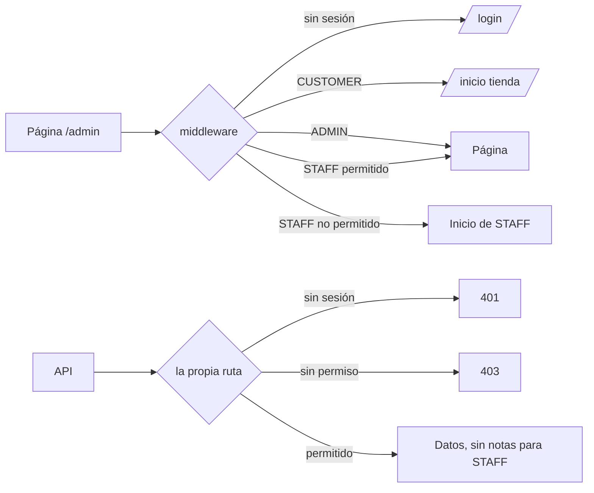

# Plan: Ticket #21 — Rol STAFF (Asistente) con permisos centralizados y menú por rol

**Rama**: `feat/staff-role-permissions` (desde `main`, con #20 incluido) · **Complejidad**: Media-alta (esquema, middleware, sidebar y ~15 rutas) · **Estado**: v3, APROBADO en Plan Canvas (fb-61, 2026-11-06)
**English summary**: Add a generic `STAFF` value to `UserRole` (shown as "Asistente" in health), one permissions map (`src/lib/permissions.ts`) read by middleware, pages, sidebar and the APIs STAFF uses. Every other API already rejects any role that is not ADMIN, so it stays untouched. STAFF reaches Citas, WhatsApp and Historial with action-level limits (no clinical notes, no deletes) and starts at Citas. Local tests use signed session cookies, no temporary code in `src/`. **No commit and no push until the owner validates by hand.** Each phase ends with an AskUserQuestion checkpoint.

## Cambios de la v2 a la v3 (revisión contra el código, 2026-11-05)

| Hallazgo | Cambio |
|---|---|
| Las 53 rutas ya responden 403 a cualquier rol que no sea ADMIN | Solo cambian las ~15 rutas que usa STAFF; el resto queda igual |
| Forzar el rol en el callback `session` no llega al middleware (`getToken`) ni a `getAppSession` (decodifica la cookie) | Cookie de sesión firmada por un script de `local-utils/`; sin `TEMP-FORCE-ROLE` |
| Un layout de Next 14 no recibe la ruta ni se re-ejecuta al navegar entre páginas hijas | `admin/layout.tsx` solo valida ADMIN o STAFF; segunda puerta en las 4 páginas que leen la base en el servidor |
| El middleware no protege APIs (el `matcher` excluye `api/apps` y `api/calendar`) | Diagrama corregido: la API se protege solo dentro de cada ruta |
| `POST /api/appointments` trata a quien no es ADMIN como cliente: la cita de STAFF quedaría a su nombre; `GET` le daría agenda vacía | Esas ramas usan `can()`, no `requirePermission` |
| Permisos por sección no cubren acciones delicadas | Mapa por acción (tabla "Permisos de STAFF") |
| `CreditsBadge` llama a `/api/credits` (403 para STAFF); `TrialExpiredGate` ofrece pagar | Ocultar o cambiar texto para STAFF |
| Login, `/admin/page.tsx` y middleware mandan siempre a `/admin/dashboard` | Inicio según el rol; pantalla vacía si STAFF no tiene sección visible |
| Fuga existente: `/api/campaigns/social/history` no revisa el rol | Se corrige en este ticket (lote C) |
| La línea base se medía contra un espejo que aún no existía; `GET whatsapp/status` pide un QR nuevo | Espejo al inicio de la Fase 0; rutas con efectos externos fuera de la línea base |
| **Fase 0 (2026-11-05):** el `middleware.ts` de la raíz nunca se ejecutó (con `src/app` Next.js solo lee `src/middleware.ts`; `middleware-manifest.json` vacío; en producción `www.newaigent.com/login` responde 200). Hoy la única puerta de `/admin` es `admin/layout.tsx` (no-ADMIN va a `/login`) | Decisión del dueño: mover a `src/middleware.ts` con `matcher` limitado a `/admin/:path*`. Bloqueo del dominio raíz, checkout y `/login` con sesión quedan apagados para otro ticket. En la línea base CUSTOMER en `/admin/*` va a `/login` (no a `/`) |

## Reglas de trabajo (tuyas)

- **Cero commits y cero push** hasta que valides los cambios manualmente. Lo que tienes en stage (los 3 archivos de los commands) no se toca.
- **Un paso a la vez.** Al terminar cada fase me detengo, te muestro el diff y te pregunto con AskUserQuestion si seguimos.
- **Nada contra la base real** sin tu aprobación explícita y un backup verificado. Local siempre primero, en el espejo.

## Principios de código (DRY, KISS, YAGNI)

Reglas de `.claude/rules/ecc/common/` y `.claude/rules/ecc/typescript/` (archivos de 200-400 líneas, funciones menores de 50, sin anidación profunda, sin números mágicos, validación en los límites). Lo que choque con `CLAUDE.md` se resuelve a favor de `CLAUDE.md`.

- **Una sola fuente del permiso:** el mapa de `permissions.ts` lo leen middleware, páginas, sidebar y APIs.
- **Tocar solo lo que cambia de comportamiento:** las rutas solo-ADMIN ya fallan cerrado para STAFF; migrarlas sería un refactor sin ganancia en este ticket.
- **Reutilizar:** `AdminSidebar` con filtro por rol; `StaffTitle` sigue el patrón de `CustomerSubject`; la segunda puerta sigue el patrón de `historial/layout.tsx`; el script de usuario reutiliza el hash del registro; los tipos del rol salen del enum de Prisma, no se repiten a mano.
- **YAGNI:** sin motor de permisos genérico ni roles extra. Solo `ADMIN` y `STAFF`.

## Comandos y agentes de ECC por fase

| Fase | Comando o agente | Para qué |
|---|---|---|
| 1-2 | skill `tdd-workflow` / agente `tdd-guide` | Pruebas primero del mapa y de los helpers |
| 3 | agente `database-reviewer` | Revisar `up.sql` y `down.sql` |
| 4-6 | `/ecc:code-review` al terminar cada lote (sin commitear) | Calidad del diff |
| 4-6 | `/ecc:security-scan` y agente `security-reviewer` | Es código de autorización |
| 6 | agente `silent-failure-hunter` | Ninguna ruta falla abierta con un rol desconocido |
| 8 | `/ecc:build-fix` si el build falla; `/ecc:verification-loop` al cierre | Build, tipos y pruebas |
| 9 | `/ecc:browser-qa` o chrome-devtools | Claro/oscuro y colores extremos (tú validas) |
| Cierre | `/ecc:update-codemaps` | `docs/CODEMAPS` con permisos y rol |

`/ecc:pr` y cualquier commit quedan fuera hasta que tú lo pidas.

## Decisiones tomadas

| Tema | Decisión |
|---|---|
| Secciones de STAFF | Citas, WhatsApp e Historial, con límites por acción (tabla siguiente). Todo lo demás solo ADMIN |
| Dashboard | Sin acceso. STAFF inicia en la primera sección permitida y visible (Citas si existe) |
| Historial | Exige el rol **y** el plan (candado `history` de `capabilities.ts`) |
| Notas clínicas (`internalNotes` y su historial) | Ocultas para STAFF: no se escriben y las APIs no las envían al navegador |
| APIs | Solo las ~15 rutas que usa STAFF pasan por `permissions.ts`; el resto queda con su comprobación ADMIN actual |
| Pruebas locales como STAFF | Cookie de sesión firmada por `local-utils/sign-session-cookie.ts` |
| Fuga de `/api/campaigns/social/history` | Se corrige aquí (solo ADMIN) |
| Esquema | `prisma/sql/19-staff-role/` con `up.sql` / `down.sql`, probado en el espejo; nunca `db:push` |
| Nombre del rol | `StaffTitle` en `vertical-profile.ts` + i18n. Salud "Asistente", turismo "Guía", resto (veterinaria incluida) "Personal" |
| Usuario STAFF en prod | Script que genera hash y un `.sql` con INSERT; lo ejecutas tú |

## Permisos de STAFF (por acción)

| Permiso | Rutas | STAFF |
|---|---|---|
| `appointments.view` | `GET /api/appointments` (rama agenda), `GET /api/calendar/events`, `GET /api/calendar/account` (agregada en la Fase 5: etiqueta y correo del calendario en Citas), `GET /api/appointments/availability` (sin cambio, ya es pública) | Sí, sin notas clínicas |
| `appointments.status` | `PATCH /api/appointments/[id]` con `status` (Confirmar manda WhatsApp) | Sí |
| `appointments.reschedule` | `PATCH /api/appointments/[id]` con `appointmentDate` (reprogramar; reinicia recordatorio y confirmación como hoy) | Sí |
| `appointments.book` | `POST /api/appointments` con la rama de "agendar a nombre del paciente" | Sí |
| `appointments.notes` | `PATCH /api/appointments/[id]` con `internalNotes`, `GET /api/appointments/[id]/history` | No (lectura y escritura) |
| `appointments.delete` | `DELETE /api/appointments/[id]` | No |
| `whatsapp.chats` | `GET chats`, `GET messages`, `POST chats/[id]/send`, `GET config` (la página lo necesita al cargar) | Sí |
| `whatsapp.bot` | `PATCH chats/[id]` (pausar o reanudar el bot por contacto) | Sí |
| `whatsapp.chats.delete` | `DELETE chats/[id]` | No |
| `whatsapp.confirmations` | `GET confirmations`, `POST confirmations/[id]` (confirmar o liberar; liberar cancela y manda WhatsApp) | Sí |
| `whatsapp.settings` | `PATCH /api/apps/whatsapp/config` (temperatura e identidad del bot), `GET/PATCH /api/tenants/reminders` | Sí (pestaña completa) |
| `history.view` | `GET /api/admin/historial`, `GET /api/admin/historial/[key]` | Sí con plan, sin notas clínicas |

## Página inicial de STAFF

El dashboard muestra ventas, pedidos, clientes y campañas, información que el asistente no necesita. STAFF entra a la primera sección que tenga permitida **y** visible para el negocio, en este orden: Citas (si `isBookingEnabled`), WhatsApp (si está conectado), Historial (si el plan lo incluye). Si ninguna aplica, ve una pantalla vacía con el aviso "No tienes secciones disponibles; habla con el responsable del negocio" (i18n), nunca un bucle de redirecciones. Un dashboard recortado queda para el ticket 3.

## Dónde se revisa el rol (defensa en profundidad)

1. **Middleware** (`middleware.ts`): páginas `/admin/*`. ADMIN y STAFF entran; STAFF fuera de sus secciones va a su página inicial. No toca APIs.
2. **Páginas de servidor que leen la base directo**: `dashboard`, `asistente`, `pedidos`, `pedidos/[id]` (y `/admin/page.tsx`, que hoy redirige a dashboard). Llaman a un helper de servidor que redirige a STAFF aunque el middleware fallara. Las otras páginas del admin son de cliente y sus datos solo llegan por APIs.
3. **Cada ruta de API**: es la protección real. Las de STAFF usan `permissions.ts`; las demás conservan `role !== "ADMIN"` y ya responden 403.
4. **`admin/layout.tsx`**: solo acepta ADMIN o STAFF y pasa el rol al menú. No puede revisar la sección (un layout no recibe la ruta y no se re-ejecuta al navegar).

## Flujo de una petición



## Fases (cada una termina con un punto de control contigo)

### Fase 0 — Espejo y línea base (sin tocar código de `src/`)
- `/local-db-mirror refresh` (requiere tu visto bueno antes de leer la base real con `pg_dump`, que solo lee).
- `local-utils/sign-session-cookie.ts`: firma una cookie `next-auth.session-token` con `encode` de `next-auth/jwt` y el `NEXTAUTH_SECRET` local, para un `userId`, `tenantId` y rol dados (STAFF incluido, aunque aún no exista en la base). Se niega a correr si `NODE_ENV=production`. Imprime solo la cookie, nunca el secreto.
- Inventario estático: todas las comprobaciones de rol en `src/` y `middleware.ts` (archivo, método HTTP, tipo de comprobación), guardado en `local-utils/role-baseline.json` (ignorado por git).
- Matriz de respuestas (status y redirección, no contenido) sin sesión / CUSTOMER / ADMIN contra el servidor local sobre el espejo: todas las páginas `/admin/*`, las ~15 rutas de STAFF y una ruta solo-ADMIN por carpeta. **Excluidas** por efectos externos: `GET /api/apps/whatsapp/status` (pide QR nuevo), `oauth/*/start` y `callback`, `billing/*`, y cualquier POST/PATCH/DELETE.
- Capturas del menú del ADMIN (claro y oscuro) fuera del repo.
- **Punto de control:** confirmas que es la foto correcta.

### Fase 1 — Pruebas primero (RED)
- `local-utils/permissions.test.ts` (`node:test`):
  - ADMIN puede todo; STAFF solo los permisos marcados "Sí"; `CUSTOMER` y un rol desconocido no pueden nada; un permiso sin entrada es solo ADMIN.
  - Rol por plan (ADMIN/STAFF × Start/Plus/Pro): `history.view` exige ambos.
  - `staffHomePath()`: Citas, luego WhatsApp, luego Historial, luego la pantalla vacía.
  - `canAccessAdminPath(role, pathname)` para el middleware, incluyendo subrutas (`/admin/historial/abc`) y rutas parecidas (`/admin/citas-x` no cuenta como Citas).
  - `omitClinicalNotes()` quita `internalNotes` y el historial de notas para STAFF y no muta el objeto original.
- Prueba de cableado: cada una de las ~15 rutas de STAFF importa `permissions.ts`; ninguna ruta de `src/app/api` deja pasar comparando contra `"CUSTOMER"`.

### Fase 2 — Mapa y helpers (`src/lib/permissions.ts`)
- Mapa rol → permisos de la tabla anterior.
- `can(role, permiso)` puro; `requirePermission(session, permiso)` para APIs (401 sin sesión, 403 sin permiso; `tenantId` siempre de la sesión); `canAccessAdminPath`; `staffHomePath(ctx)`; `omitClinicalNotes`.
- Regla segura: lo que no aparece para STAFF es solo ADMIN.

### Fase 3 — Esquema (con `/local-db-mirror`)
- `prisma/sql/19-staff-role/up.sql`: `ALTER TYPE "UserRole" ADD VALUE 'STAFF'` (aditivo; solo agrega el valor, porque no puede usarse en la misma transacción).
- `down.sql` a mano: primero borra los usuarios con rol STAFF (o falla con un mensaje si existen, a decidir con `database-reviewer`), después recrea el tipo sin el valor. Documentado en el archivo.
- `/local-db-mirror test-sql 19-staff-role`: diff de Prisma antes, después de `up` y después de `down`; único resto esperado `DROP TABLE "whatsapp_bot_memory"`.
- `schema.prisma` actualizado.
- **Puerta humana:** backup verificado y tu aprobación antes de aplicar nada a la base real. En este ticket **no se aplica a la real** hasta que tú lo pidas.

### Fase 4 — Sesión, entrada y puertas de página
- `src/types/next-auth.d.ts`: el rol sale del enum de Prisma (`$Enums.UserRole`), no de `"CUSTOMER" | "ADMIN"` repetido 3 veces.
- `middleware.ts`: ADMIN y STAFF entran a `/admin/*`; STAFF usa `canAccessAdminPath` y fuera de eso va a su inicio; `/login` y `/registro` con sesión redirigen según el rol.
- `/login` (línea 38) y `/admin/page.tsx`: inicio según el rol en vez de `/admin/dashboard` fijo. `registro/page.tsx:46` igual.
- `admin/layout.tsx`: acepta ADMIN o STAFF, pasa el rol al menú.
- Segunda puerta en `dashboard`, `asistente`, `pedidos`, `pedidos/[id]`.
- Pantalla vacía de STAFF sin secciones (i18n, `lucide-react`, tema del tenant).

### Fase 5 — Menú y piezas alrededor
- `AdminSidebar` recibe el rol y filtra con el mismo mapa; los candados de plan siguen aplicando encima.
- `CreditsBadge` oculto para STAFF (llama a `/api/credits`).
- `TrialBanner` y `TrialExpiredGate`: para STAFF, texto "habla con el responsable del negocio" en vez del botón de pago.
- `/admin/citas`: botón de notas clínicas y borrar oculto para STAFF.
- `/admin/whatsapp`: botón de borrar chat oculto para STAFF.
- Tienda: `Navbar` muestra el enlace al CRM también a STAFF; `ReviewSection` sigue solo ADMIN.

### Fase 6 — APIs en 3 lotes (solo las de STAFF)
- **Lote A, citas:** `appointments` (GET y POST con `can()` en las ramas mixtas), `appointments/[id]` (PATCH: estado y `appointmentDate` sí, `internalNotes` solo ADMIN; DELETE sin cambio), `calendar/events` (sin notas para STAFF). `appointments/[id]/history` sin cambio (sigue solo ADMIN).
- **Lote B, WhatsApp:** `chats`, `chats/[id]` (PATCH STAFF, DELETE sin cambio), `chats/[id]/send`, `messages`, `config` (GET y PATCH), `confirmations`, `confirmations/[id]`, `tenants/reminders`.
- **Lote C, historial y fuga:** `admin/historial`, `admin/historial/[key]` (sin notas para STAFF), `campaigns/social/history` (agrega la comprobación ADMIN que falta).
- Después de **cada lote**: matriz contra la línea base (ADMIN idéntico, STAFF según la tabla), pruebas y `tsc`. Sin commit. Punto de control con AskUserQuestion.

### Fase 7 — Nombre del rol por giro

```ts
export type StaffTitle = "assistant" | "guide" | "staff";
// HEALTH -> assistant ("Asistente") · TOURISM, TRAVEL -> guide ("Guía") · resto, veterinaria incluida -> staff ("Personal")
```

- `VerticalProfile.staffTitle` y claves i18n (`es`, `en`, `types`): "Asistente" / "Assistant", "Guía" / "Guide", "Personal" / "Staff". Sin texto fijo en componentes.

### Fase 8 — Verificación local
- `npx tsx --test local-utils/*.test.ts`, `npx tsc --noEmit`, `npm run build` sin errores (con el servidor de desarrollo detenido, comparten `.next`).
- Servidor local contra el **espejo** (`/local-db-mirror env`), nunca contra la real.

### Fase 9 — Prueba manual contigo
- Cookie STAFF firmada en el navegador (o usuario STAFF real en el espejo tras la Fase 3): menú, inicio, redirecciones, 403, notas ocultas, nombre del rol, claro y oscuro, colores del tenant muy claros y muy oscuros, un negocio sin citas y uno sin WhatsApp. Capturas fuera del repo.
- **Hasta que digas que está bien no hay commit.**

### Fase 10 — Usuario STAFF para producción (por query)
- `local-utils/create-staff-user.ts`: recibe tenant, correo, nombre y contraseña por parámetros, genera el hash bcrypt como el registro y escribe un `.sql` con el `INSERT` (la contraseña nunca se guarda ni se imprime).
- Primero en el espejo, con inicio de sesión real como STAFF.
- Guía en `docs/`: backup, orden (base primero y código después), `psql -v ON_ERROR_STOP=1 -1`, verificación y cómo borrar el usuario de prueba.
- **Yo no ejecuto nada en la base real.**

## Pruebas de API con curl (para Postman)

- `local-utils/staff-api-curls.md` (ignorado por git hasta que pidas compartirlo): un `curl` por cada permiso de STAFF (permitido y negado), para ADMIN y STAFF, con el resultado esperado (200, 401 o 403).
- La cookie sale de `sign-session-cookie.ts` y va en la variable `{{cookie}}`: `-H "Cookie: next-auth.session-token={{cookie}}"` más `-H "Host: doctor.localhost:3000"`. Importable con "Import → Raw text".
- Sin cookies ni contraseñas escritas en el archivo. Solo contra el servidor local sobre el espejo.

## Plan de pruebas: actual vs nuevo

| Caso | Sin sesión | CUSTOMER | ADMIN (actual = nuevo) | STAFF (nuevo) |
|---|---|---|---|---|
| `/admin/dashboard`, `/admin` | login | inicio tienda | entra | inicio de STAFF |
| `/admin/citas` | login | inicio tienda | entra | entra: estado, reprogramar y agendar; sin notas ni borrar |
| `/admin/whatsapp` | login | inicio tienda | entra | entra, sin borrar chat |
| `/admin/historial` | login | inicio tienda | entra con plan | entra con plan; sin plan, igual que ADMIN hoy |
| Resto de `/admin/*` | login | inicio tienda | entran | inicio de STAFF |
| APIs de la tabla "Permisos de STAFF" marcadas Sí | 401 | 403 (las públicas, igual que hoy) | 200 | 200 |
| APIs marcadas No y resto de APIs ADMIN | 401 | 403 | 200 | 403 |
| `/api/campaigns/social/history` | 401 | **hoy 200 (fuga), nuevo 403** | 200 | 403 |
| APIs internas (`x-internal-key`) | sin cambio | — | — | no aplica |
| `/login` con sesión | — | `/` | `/admin/dashboard` | inicio de STAFF |
| Negocio sin citas ni WhatsApp, plan Start | — | — | igual | pantalla vacía, sin bucle |

Aceptación: ninguna celda de ADMIN cambia; en CUSTOMER cambian la fuga corregida y, por decisión del dueño (lote A, 2026-11-06), el 401 pasa a 403 en las rutas que ahora usan `requirePermission` (401 = sin sesión, 403 = sesión sin permiso); cualquier otra diferencia detiene el lote. Eventos externos del calendario: STAFF los ve igual que ADMIN (decisión del dueño, lote A).

## Criterios de aceptación del ticket

- [ ] STAFF no abre `/admin/negocio`, `/admin/productos` ni otras secciones no permitidas (redirige a su inicio)
- [ ] Rutas de API no permitidas responden 403 con sesión STAFF
- [ ] STAFF nunca recibe `internalNotes` ni el historial de notas en ninguna respuesta
- [ ] Una cita agendada por STAFF queda a nombre del paciente, no del STAFF
- [ ] ADMIN ve y hace exactamente lo mismo que antes (demostrado con la línea base)
- [ ] Menú de STAFF solo muestra lo permitido; sin badge de créditos
- [ ] El nombre del rol cambia según el giro (salud y turismo, mínimo)
- [ ] Pruebas del mapa cubren ADMIN, STAFF, CUSTOMER, rol desconocido y plan
- [ ] Claro/oscuro y colores extremos del tenant
- [ ] PR con capturas (cuando tú lo pidas; no antes)

## Riesgos

| Riesgo | Mitigación |
|---|---|
| Código desplegado antes que la base | Orden fijo: base primero, código después (un merge a `main` despliega). Este ticket no aplica a la real sin tu orden |
| Una ruta de STAFF olvida quitar las notas clínicas | `omitClinicalNotes` probado y prueba de cableado; `security-reviewer` en los lotes A y C |
| Una rama mixta (cliente/admin) trata a STAFF como cliente | `can()` explícito en `appointments` GET/POST; prueba de que la cita queda a nombre del paciente |
| El rol vive en el JWT 30 días y no se relee de la base | Sin efecto en este ticket; **bloquea el ticket 2** (desactivar usuarios necesita releer el rol) |
| STAFF libera citas (cancela y manda WhatsApp) y edita la identidad del bot | Decisión tuya; queda en la tabla de permisos y en la prueba manual |
| Cambio de enum con sesiones existentes | Los ADMIN actuales no cambian; `getToken()` solo lee un string |
| El espejo desactualizado da falsos resultados | `/local-db-mirror refresh` al inicio de la Fase 0 |

## Fuera de alcance

Crear o desactivar usuarios desde pantalla (ticket 2), lo que hace el asistente dentro de agenda y WhatsApp más allá de esta tabla (ticket 3), migrar las rutas solo-ADMIN al helper, flags de historial y campañas (#20), dashboard recortado para STAFF, plan de pago por rol, término de veterinaria.
