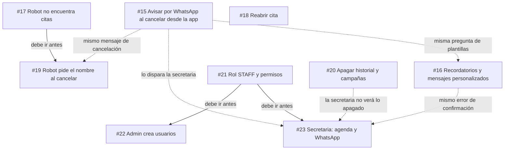
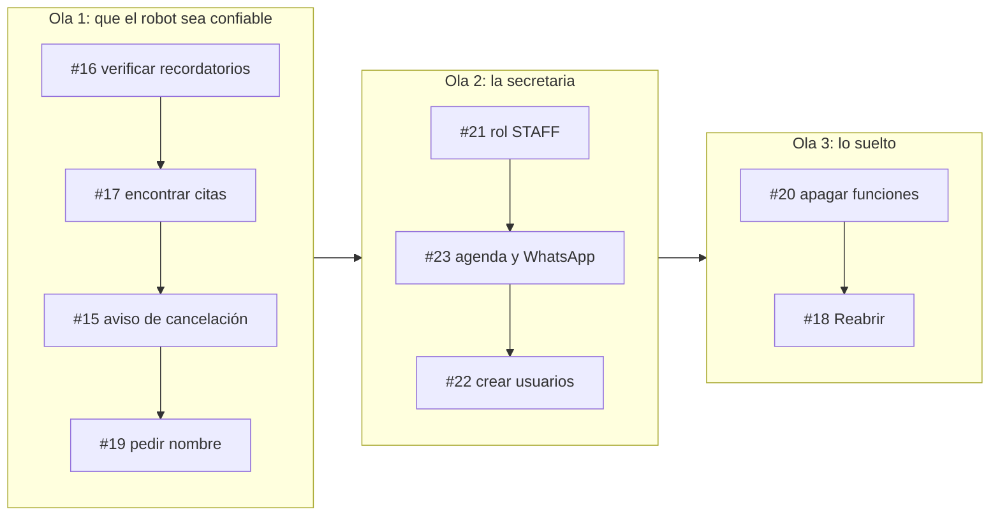
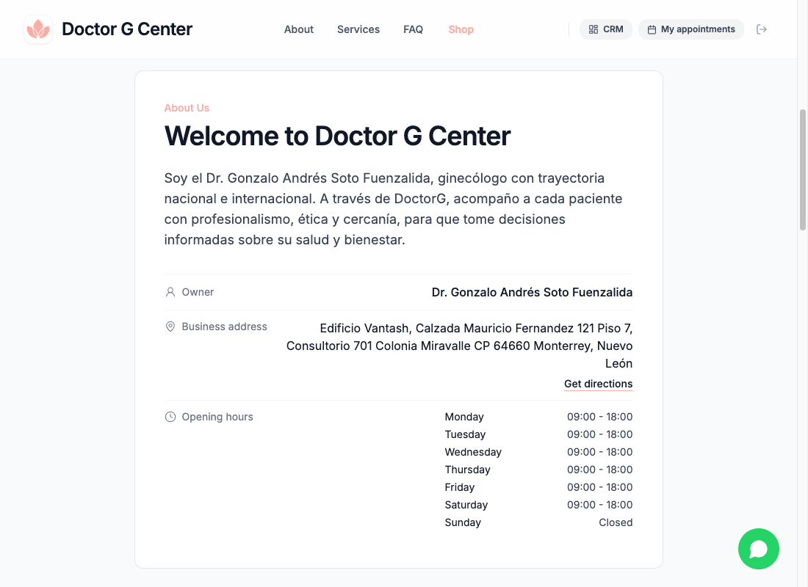
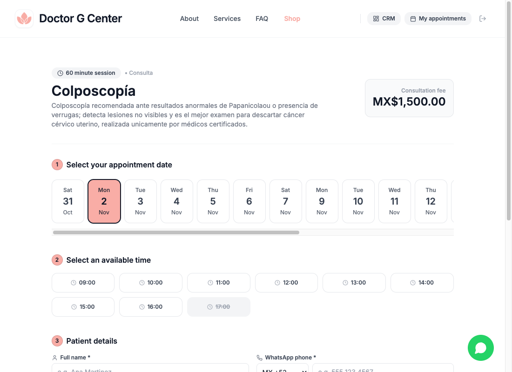
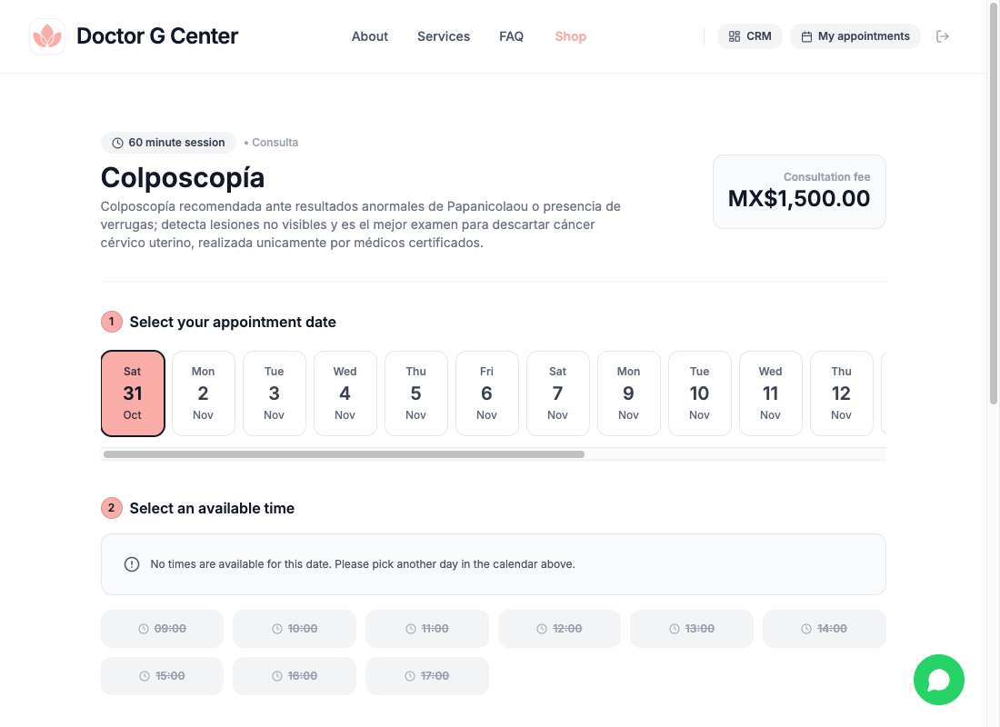

# Tickets Newy #15 a #23: mapa, orden y decisiones

Origen: sesión de transferencia de conocimiento del 2026-10-29 y ajustes del 2026-10-30. Cliente de salud próximo a producción. Tablero: proyecto Newy (#3), repo `smartflows-ai/nutriologas`.

Cómo usar este canvas: apunta a cualquier bloque para comentar, y responde las preguntas marcadas como **PREGUNTA** al final de cada ticket o en la sección de preguntas abiertas. Al terminar, usa Approve plan o Request changes.

---

## La idea completa, para un niño de 10 años

Imagina una **tienda de citas del doctor**. Los pacientes pueden pedir su cita de dos maneras: en la página web, o hablando con un **robot por WhatsApp** que hace de recepcionista.

Después de la reunión encontramos **cosas que se rompen o faltan**:

- El robot a veces **no encuentra** la cita de un paciente, aunque sí existe (#17).
- Cuando la cita se cancela desde la página, **nadie le avisa** al paciente (#15).
- Hay citas sin confirmar a las que **nadie les manda el recordatorio** (#16).
- Un botón "Reabrir" **no hace bien su trabajo** (#18).
- Si el robot no encuentra al paciente por su número, debería **preguntarle su nombre** (#19).

Y también cosas **nuevas que el cliente necesita**:

- Una **secretaria** que pueda usar la agenda y contestar WhatsApp, sin ver lo secreto del doctor (#21, #22, #23).
- Poder **apagar dos funciones** (historial y campañas) que el cliente no compró (#20).

Son 9 tickets. Algunos dependen de otros, como armar una casa: primero los cimientos, luego las paredes.

---

## Mapa de relaciones

Líneas continuas: no se puede hacer uno sin el otro. Líneas punteadas: se tocan y conviene coordinarlos.

| Ticket | Depende de | Se toca con |
|---|---|---|
| #15 | nada | #16, #19, #23 |
| #16 | nada | #15, #23 |
| #17 | nada | #19 |
| #18 | nada | nada (síntoma sin describir) |
| #19 | #17 | #15 |
| #20 | nada | #23 |
| #21 | nada | todos los de roles |
| #22 | #21 | nada |
| #23 | #21 | #15, #16, #20 |

---

## Orden recomendado

| # | Ticket | Prioridad | Tamaño | Por qué en este lugar |
|---|---|---|---|---|
| 1 | #16 | P1 | M | Es verificar si el workflow de recordatorios siquiera está activo. Si no lo está, el cliente no recibe ninguno. |
| 2 | #17 | P1 | S | Es el error que más ve el paciente hoy, y #19 no se puede hacer sin él. |
| 3 | #15 | P1 | S | Corto. Antes hay que contestar la pregunta de las plantillas. |
| 4 | #19 | P1 | M | Cierra el flujo de cancelación del robot. |
| 5 | #21 | P1 | L | Cimientos de los roles. Bloquea a #22 y #23. |
| 6 | #23 | P1 | L | Lo que realmente usa la secretaria todos los días. |
| 7 | #22 | P1 | L | Permite que el doctor cree a su secretaria. Mientras tanto se puede crear a mano. |
| 8 | #20 | P1 | M | No bloquea nada, pero el cliente podría ver funciones que no compró. |
| 9 | #18 | P2 | M | Su síntoma aún no está claro. |

**DECIDIDO (orden):** de acuerdo con el orden. La idea es no cargar a la secretaria con tareas repetitivas y que mantenga acceso a la app solo según su rol. Si la secretaria entra desde el día uno, #21 y #23 pasan a la Ola 1.

---

## Ticket por ticket

### #17 El bot de WhatsApp no encuentra las citas creadas desde la web

**Para un niño de 10 años:** El paciente apunta su número en la libreta de la tienda como "+52 844 668 3688". El robot lo busca como "5218446683688". Es el mismo número, pero escrito distinto, y el robot dice "no te encuentro". La solución es que el robot compare los números por sus dígitos, no por cómo están escritos.

**Qué es:** `bot/my-appointments` y `bot/cancel` filtran `customerPhone` por texto exacto. `Appointment.patientKey` ya normaliza el teléfono (52 + 10 dígitos), pero estas rutas no lo usan.

**Decisión tomada:** corregir el cruce de teléfonos primero. Causa probable revisada en código, no probada con datos reales.

**Impacto:** quita el error más visible para el paciente. Es lo que desbloquea #19. Riesgo bajo si se filtra siempre por `tenantId` y nunca se muestran citas de otro número.

**Tamaño y prioridad:** S, P1.

**DECIDIDO:** el caso de prueba es el número `528111813540`, solo para local. Quedó detrás de la variable `DEV_WHATSAPP_NUMBER` en `src/app/(public)/layout.tsx` (no aplica en producción; sin la variable se usa `tenant.whatsappNumber`). Falta un caso real con número web y número del bot para confirmar la causa.

---

### #19 Flujo alterno del bot: pedir el nombre cuando no se encuentra la cita

**Para un niño de 10 años:** Si el robot no te encuentra por tu número, en vez de rendirse te pregunta: "¿cómo te llamas?". Si hay una sola cita con ese nombre, te la muestra y te pregunta si de verdad quieres cancelarla.

**Qué es:** respaldo cuando no hay coincidencia por teléfono. Busca por `customerName`, exige coincidencia única y confirmación explícita.

**Decisión tomada:** el nombre es respaldo, no la forma principal de identificar. Primero se usa el teléfono.

**Impacto:** relaja la regla de "solo el número que reservó puede cancelar". Por eso exige confirmación y coincidencia única, y nunca revela datos de otros pacientes. Parte del cambio vive en n8n, fuera del repo.

**Depende de:** #17. **Tamaño y prioridad:** M, P1.

**DECIDIDO:** por ahora se cancela por nombre. Mejora acordada: un código por cita, que llega en el mensaje de recordatorio y confirmación. El paciente lo escribe al bot para cancelar, más seguro que el nombre. Implica guardar un código en cada cita, mostrarlo en los mensajes y validarlo en `bot/cancel`.

---

### #15 Mensaje de cancelación por WhatsApp cuando el admin o la secretaria cancela

**Para un niño de 10 años:** Cuando la secretaria tacha una cita en la página, el paciente no se entera. Hay que mandarle un mensajito: "tu cita fue cancelada".

**Qué es:** `PATCH /api/appointments/[id]` con `CANCELLED` no envía WhatsApp. Solo `CONFIRMED` envía mensaje, con texto fijo.

**Decisión tomada:** solo avisa cuando cancela el admin o la secretaria. Si el paciente cancela desde `/mis-citas` o marca "no vino", no se manda este mensaje.

**Impacto:** el paciente deja de presentarse a una cita ya cancelada. Se cruza con #23 (la secretaria será quien más cancele) y con #19 (el robot también cancela).

**Tamaño y prioridad:** S, P1.

**DECIDIDO:** el mensaje es personalizable, usa `cancellationTemplate` y respeta el idioma del negocio.

---

### #16 Probar recordatorios a citas sin confirmar, y mensajes personalizados

**Para un niño de 10 años:** Hay un despertador que debería avisar al paciente "tu cita es mañana, ¿confirmas?". No sabemos si el despertador está encendido. Primero hay que ver si suena; si no suena, buscar por qué. Después, comprobar que el doctor pueda cambiar lo que dice el mensaje.

**Qué es:** probar de punta a punta el flujo de `reminders/run`, clasificar cada hueco como falla o como exclusión de diseño, y corregir solo las fallas. Incluye una sección de pruebas de mensajes personalizados.

**Decisión tomada:** no forzar recordatorios por encima de `remindersEnabled` ni `confirmationRequired`. Exclusiones aceptadas: sin teléfono, reservada tarde con ventana menor a 30 min, recordatorios apagados.

**Impacto:** es el ticket de mayor riesgo para el cliente. El workflow de n8n no está en el repo, así que nadie ha podido confirmar si está activo. Si no lo está, ningún paciente recibe recordatorio. Incluye el hueco de que una falla de envío hoy es silenciosa.

**Tamaño y prioridad:** M, P1.

**DECIDIDO:** tienes acceso a todo el flujo de n8n. Lo revisas tú (activo, intervalo, URL) antes de tocar código; el JSON del flujo no está en el repo.

---

### #21 Roles: rol STAFF con permisos centralizados y menú por rol

**Para un niño de 10 años:** Hoy la tienda tiene una sola llave: la del doctor, que abre todo. Vamos a hacer una **llave más chica** que abre solo algunas puertas. Además, en vez de que cada puerta decida por su cuenta quién pasa, habrá **una lista central** de quién puede abrir qué.

**Qué es:** nuevo valor `STAFF` en `UserRole`, mapa de permisos en `src/lib/permissions.ts`, middleware y layout que dejan entrar a STAFF solo a rutas permitidas, y menú que cambia según el rol.

**Decisión tomada:** rol genérico "STAFF" (no "secretaria"), para servir también a turismo (guía). Regla segura por defecto: lo que no tenga permiso explícito sigue siendo solo del admin.

**Impacto:** es el cimiento. Bloquea a #22 y #23. Requiere cambio de esquema (`npm run db:push`). Es el único donde un error podría abrir puertas de más, por eso el "cerrado por defecto".

**Tamaño y prioridad:** L, P1.

**DECIDIDO:** el nombre del rol cambia según el giro (Secretaria en salud, Guía en turismo, etc.).

---

### #23 La secretaria gestiona la agenda y atiende chats de WhatsApp

**Para un niño de 10 años:** La secretaria puede hacer todo lo de la agenda: confirmar, cancelar, marcar que el paciente vino o no vino, y cambiar la hora. También puede contestar mensajes de WhatsApp cuando hace falta una persona real. Pero **no ve las notas secretas del doctor ni los precios**, y no toca la configuración.

**Qué es:** abrir a STAFF la agenda completa y las acciones sobre citas, más las pestañas Chats y Confirmaciones de `/admin/whatsapp`. Incluye la corrección de que confirmar a mano no registraba `customerConfirmedAt` (y por eso la cita podía liberarse sola).

**Decisiones tomadas:** sin notas clínicas ni precio; reagendar solo a horarios libres (encimar sigue siendo del admin); WhatsApp sin la pestaña Configuración. Instrucción del cliente del 2026-10-30.

**Impacto:** es lo que la secretaria usa todo el día. Las conversaciones de WhatsApp pueden contener datos de salud del paciente; el acceso se concede por decisión del negocio. La corrección de confirmación también cambia el comportamiento del admin, y se cruza con #16.

**Depende de:** #21. **Tamaño y prioridad:** L, P1.

**DECIDIDO:** confirmado. El doctor no tiene tiempo de leer mensajes porque está atendiendo u operando, así que la secretaria atiende los chats.

---

### #22 El admin crea, restablece y desactiva usuarios de personal

**Para un niño de 10 años:** El doctor necesita poder **hacerle una llave nueva a su secretaria**, cambiársela si la pierde y **quitársela** si ya no trabaja ahí. Hoy eso solo lo podría hacer un programador.

**Qué es:** pantalla y API para listar, crear, restablecer contraseña y desactivar usuarios. Límite de 2 usuarios en total. Campo `isActive`. Solo acceso por correo y contraseña.

**Decisiones tomadas:** el admin define la contraseña y la puede restablecer; no hay correo ni "olvidé mi contraseña" (la plataforma no tiene correo). Si el correo ya es de un cliente, se rechaza.

**Impacto:** hay un riesgo que el ticket debe resolver: la sesión dura 30 días, así que si el doctor despide a la secretaria, ella seguiría dentro hasta que venza. Por eso se revisa el estado en cada petición.

**Depende de:** #21. **Tamaño y prioridad:** L, P1.

**DECIDIDO:** como en AWS: el admin genera una contraseña temporal y la persona la cambia después. Esto agrega al #22 una pantalla de cambio de contraseña y una marca de "debe cambiarla" en el primer ingreso. Sigue sin haber "olvidé mi contraseña" por correo (no existe el canal).

---

### #20 Poder apagar el historial y las campañas por negocio

**Para un niño de 10 años:** El cliente compró un paquete **sin** dos juguetes: el historial de pacientes y las campañas de redes sociales. Pero hoy todos los juguetes vienen incluidos. Vamos a ponerles un **interruptor** a esos dos para apagarlos en la tienda de este cliente.

**Qué es:** dos banderas por negocio (como `isAssistantEnabled`). Apagada: se oculta el menú, la página responde 404 y la API rechaza. Con campañas apagadas, n8n tampoco las recibe, así que no gasta créditos.

**Decisión tomada:** banderas por negocio, **no** un sistema de planes. "Plus" fue solo una cotización; no existe como plan en el sistema.

**Impacto:** resuelve el caso de este cliente sin sobrediseñar. Las banderas nuevas quedan encendidas por defecto, para no cambiar a los demás negocios. Quien las cambie hoy lo hará por base de datos o script.

**Tamaño y prioridad:** M, P1.

**DECIDIDO:** el rol define lo que se ve: admin y staff ven menús distintos y las APIs validan el rol (es el trabajo del #21). Las banderas del #20 apagan historial y campañas por negocio; quién las mueve sigue siendo el admin con un script al inicio.

---

### #18 Al reabrir una cita no se restaura en el calendario ni se valida el horario

**Para un niño de 10 años:** Una cita cancelada se puede "revivir" con el botón Reabrir. Pero al revivirla, no vuelve a apuntarse en el calendario ni revisa si esa hora ya la ocupó otra persona.

**Qué es:** "Reabrir" es un `PATCH` con `status: CONFIRMED`. La cancelación borra el evento del calendario externo y limpia sus datos; reabrir no los recrea ni valida disponibilidad.

**Decisión pendiente:** el síntoma exacto nunca se describió en la sesión, y este ticket se basa en lo que el código sugiere.

**Impacto:** si la hora ya fue tomada, se pueden encimar dos pacientes. Si el síntoma real es otro, el ticket estaría mal planteado.

**Tamaño y prioridad:** M, P2.

**PENDIENTE:** lo dejas para después; necesitas entender mejor qué síntomas hay y dónde. Se queda en Ola 3 sin programarse hasta reproducirlo.

---

## Historial: qué hicimos desde que entró ECC (commits de lamb1303)

Rama `experimental/ecc`. Los commits van del más viejo al más nuevo. Las capturas son del negocio de prueba `doctorg.localhost:3000` (Doctor G Center), con el código actual de la rama. Muestran el resultado final de cada cambio, no el estado en el momento de cada commit.

**Explicación para un niño de 10 años:** la tienda tiene una pantalla donde el paciente escoge día y hora para su cita. Antes, si una hora ya estaba ocupada, simplemente desaparecía, y el horario de la clínica ni siquiera se mostraba. Arreglamos eso: ahora el paciente ve el horario de la semana y ve las horas ocupadas en gris, tachadas. También instalamos las herramientas de ECC (los ayudantes de Claude) y escribimos sus reglas.

### Fase 1: instalar ECC (28 oct, sin cambios en la app)

| Commit | Qué cambió | Dónde |
|---|---|---|
| `90c5a10` feat: add impeccable skill | Se agregó la skill de diseño Impeccable (59 archivos). | `.claude/skills/` |
| `16151ee` feat: update .claude folder | Configuración inicial: agentes, reglas y skills (19 archivos). | `.claude/agents`, `.claude/rules/ecc` |
| `6edd836` docs: translate CLAUDE.md | CLAUDE.md pasó a inglés, se agregó la sección "ECC Workflow", los mapas de código y se borró `.agents/` (era de otro proyecto). Su historial quedó en `docs/DECISIONS-LEDGER.md` y `docs/CHANGELOG.md`. | `CLAUDE.md`, `docs/CODEMAPS/` |
| `3f1a222` docs: add codemap diff report | Reporte de diferencias de los mapas. | `docs/` |

### Fase 2: primer trabajo real con ECC, la reserva de citas (29 oct)

Es el primer ticket que ejecutamos con ECC. Condición común: solo aplica a negocios con `isBookingEnabled = true` (las reservas apagadas no cambian).

**1. `76272cb` fix: horario semanal en la tienda y todas las horas de inicio**
- **Qué:** la página principal del negocio nunca mostraba `Tenant.businessHours`. Ahora lista la semana, lunes primero, dentro de la tarjeta "Nosotros" con el rótulo "Horario de atención". La API de disponibilidad ahora también devuelve `allSlots` (todas las horas), además de `availableSlots` (las libres).
- **Rutas:** `src/app/(public)/page.tsx`, `src/app/api/appointments/availability/route.ts`, `src/lib/business-hours.ts` (funciones nuevas `weeklyScheduleRows` y `markSlots`), `src/i18n/{es,en,types}.ts` (`hoursLabel`).
- **Condición:** el horario solo se pinta si el negocio tiene reservas encendidas y el reglamento de horario tiene al menos una fila. Si no hay horario guardado, usa el de fábrica (lunes a sábado, 9 a 18).
- **Regla que se agregó y luego se movió:** los servicios largos (más de 60 min) avanzaban cada hora (`MAX_SLOT_STEP_MINUTES = 60`).

**2. `05591a6` feat: horas no disponibles aparecen deshabilitadas**
- **Qué:** las horas ocupadas o pasadas se ven en gris, tachadas y sin poder pulsarse, en vez de desaparecer. Además:
  - texto legible sobre el color primario del negocio (cálculo de luminancia WCAG, variable `--on-primary`);
  - si el servidor rechaza una hora porque otro paciente la tomó (`slot_unavailable`), la lista se recarga;
  - una consulta lenta ya no pisa las horas del día que se eligió después;
  - se quitaron colores fijos (ámbar, rosa) y la escala al hover, por la regla de estilo minimalista.
- **Ruta:** `src/components/shop/BookingFlow.tsx` (95 líneas agregadas, 47 quitadas).
- **Condición:** sirve a todo giro agendable y a cualquier color del negocio, claro u oscuro.

Lunes 2 de noviembre, Colposcopía (60 min): las 17:00 aparecen en gris y tachadas porque ya están tomadas.

Hoy (sábado 31): todas las horas ya pasaron, así que salen deshabilitadas y se muestra el aviso de "sin horarios".

**3. `668228a` docs: se documentó lo anterior**
- `CLAUDE.md` y `docs/CHANGELOG.md`: horario en la tienda, avance de horas y horas deshabilitadas.

**4. `7a269a9` fix: servicios largos cada 30 minutos y lista pulida**
- **Qué:** un servicio de 90 min podía empezar en la media hora. Después de un conflicto, la página se desplaza de vuelta a la lista de horas. Se corrigió la sangría del JSX y el espacio entre el mensaje "sin horas" y la lista deshabilitada.
- **Rutas:** `src/lib/business-hours.ts`, `src/components/shop/BookingFlow.tsx`, `CLAUDE.md`, `docs/CHANGELOG.md`.

**5. `ebc11c8` fix: cada servicio avanza según su propia duración (revierte el punto 4)**
- **Qué:** se quitó el paso de 30 minutos. Cada servicio ofrece inicios en múltiplos de su duración dentro del horario (120 min: 9, 11, 13, 15). Las horas ocupadas o pasadas siguen visibles y deshabilitadas.
- **Rutas:** `src/lib/business-hours.ts` (10 líneas menos), `CLAUDE.md`, `docs/CHANGELOG.md`.
- **Resultado neto de los commits 1, 4 y 5:** `daySlots` quedó con el paso original (la duración del servicio). Lo que sí se quedó fue el horario visible, `allSlots` y las horas deshabilitadas.

**6. `e67f7d9` feat: los botones "Get Started" abren el registro**
- **Qué:** los botones del menú y de la portada ahora abren el modal de registro en vez de bajar a precios. El texto cambió a "Start Free Trial" / "Iniciar prueba gratis".
- **Rutas:** `src/components/marketing/MarketingPage.tsx`, `src/i18n/{es,en}.ts`.
- **Condición:** solo la página de marketing del dominio raíz (no es un negocio).

**7. `d9ecec8` docs: PRD y críticas de Impeccable**
- `.claude/prds/booking-flow-visual-polish.prd.md` y 3 reportes de crítica en `.impeccable/critique`. El PRD dice que el verdadero objetivo era probar el flujo ECC + Impeccable sobre una pantalla pequeña, no resolver un problema probado de usuarios.

### Lo que queda pendiente de esa fase
- Los commits anteriores al 28 oct (Conekta, FAQ, categorías, calendario) no se incluyeron porque son de antes de ECC.
- Pendiente de CLAUDE.md: `npm run db:push` (campos del bot y nuevos) y probar recordatorios de punta a punta.

---

## Preguntas abiertas (resumen)

| # | Ticket | Pregunta | Mi recomendación |
|---|---|---|---|
| 1 | #15 | ¿Plantilla del negocio o texto fijo? | Plantilla del negocio |
| 2 | #16 | ¿Quién revisa n8n y cuándo? | Hacerlo antes que cualquier otra cosa |
| 3 | #17 | ¿Hay un caso real para confirmar la causa? | Sí, con un número web y uno del bot |
| 4 | #18 | ¿Cuál es el síntoma exacto de Reabrir? | Reproducirlo antes de programar |
| 5 | #19 | ¿Nombre solo, o nombre y fecha? | Nombre, con confirmación explícita |
| 6 | #20 | ¿Quién cambia las banderas y dónde? | Script al inicio, interruptor después |
| 7 | #21 | ¿Nombre del rol fijo o por giro? | Por giro |
| 8 | #22 | ¿Cómo se entrega la contraseña inicial? | Fuera del sistema, por WhatsApp |
| 9 | #23 | ¿El cliente aceptó que la secretaria lea los chats? | Dejarlo por escrito |
| 10 | Orden | ¿La secretaria va antes que el robot? | Solo si entra desde el día uno |
