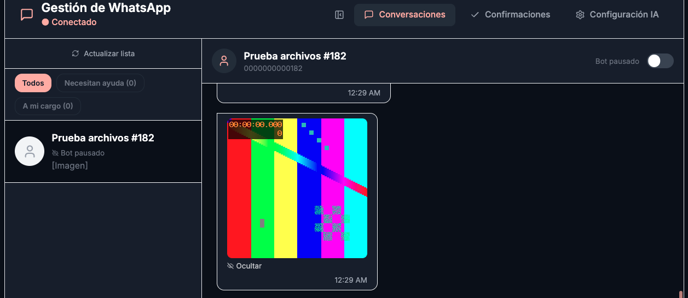
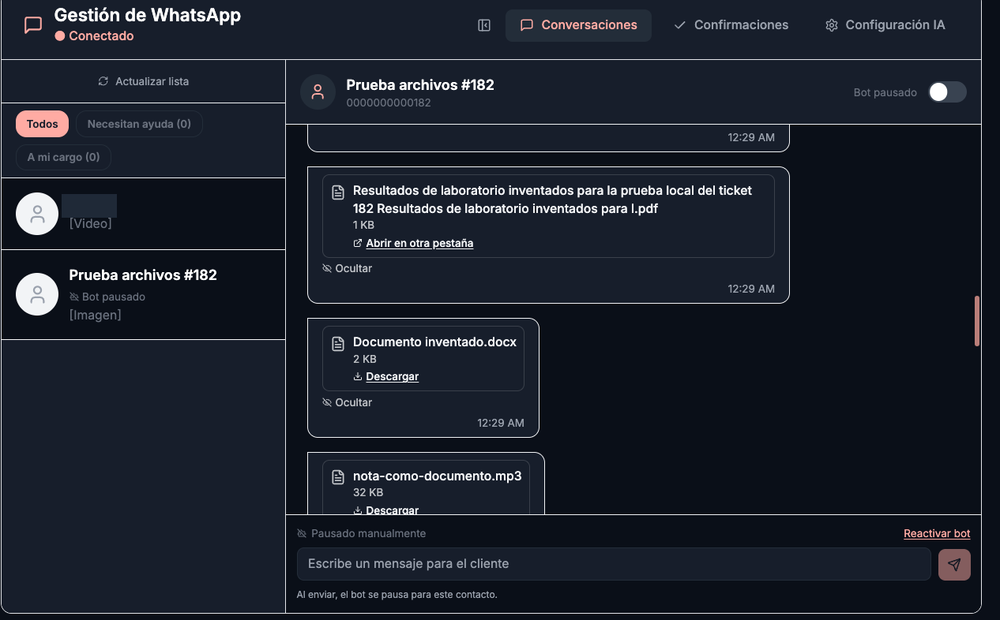
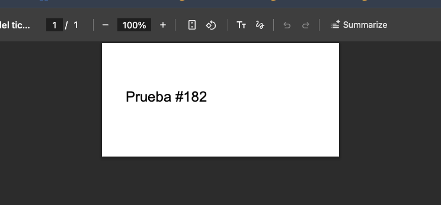
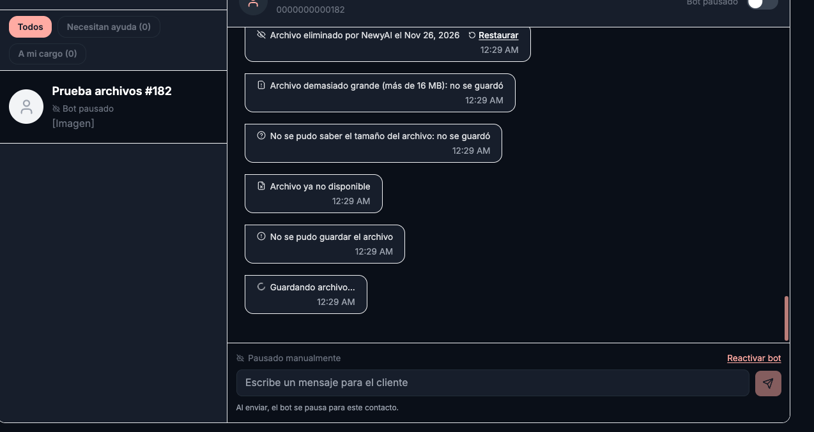
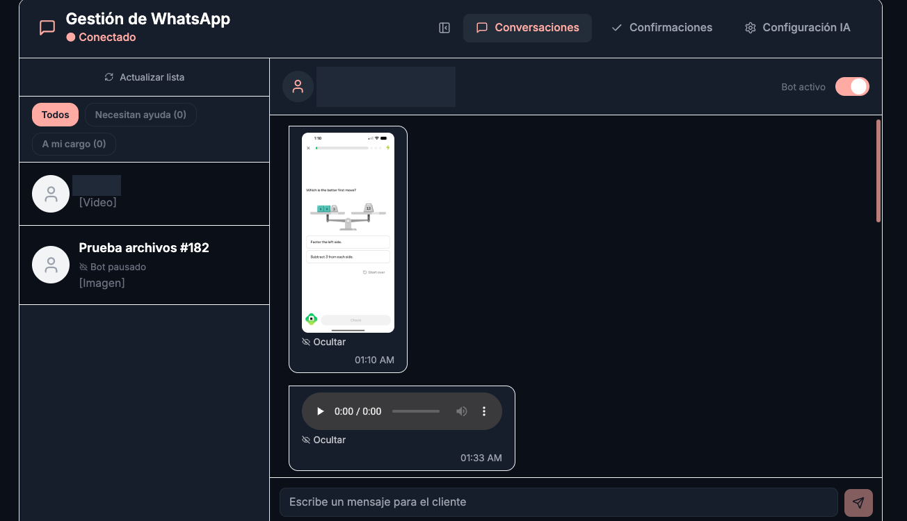
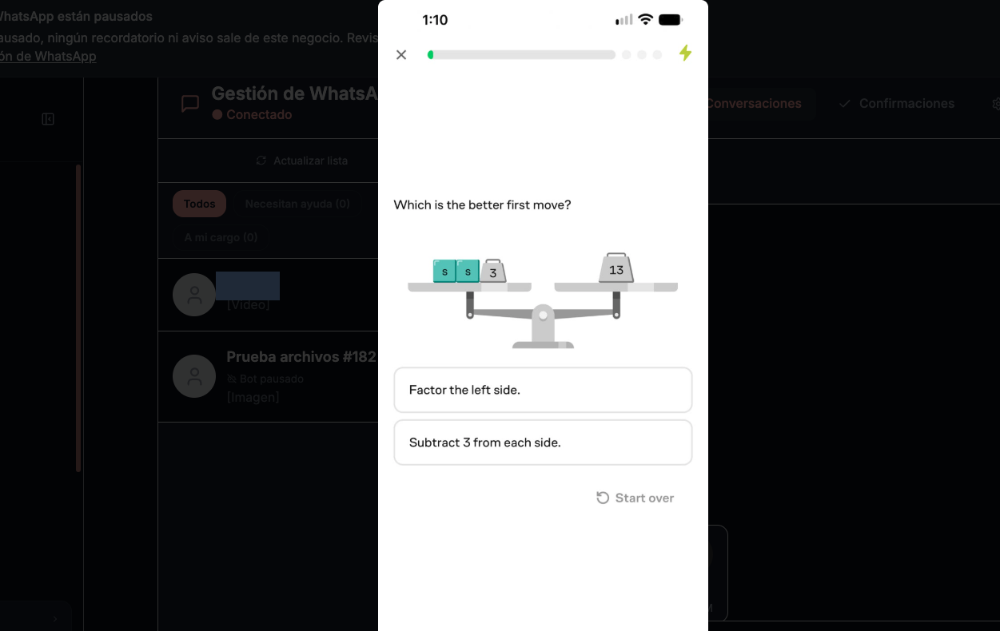
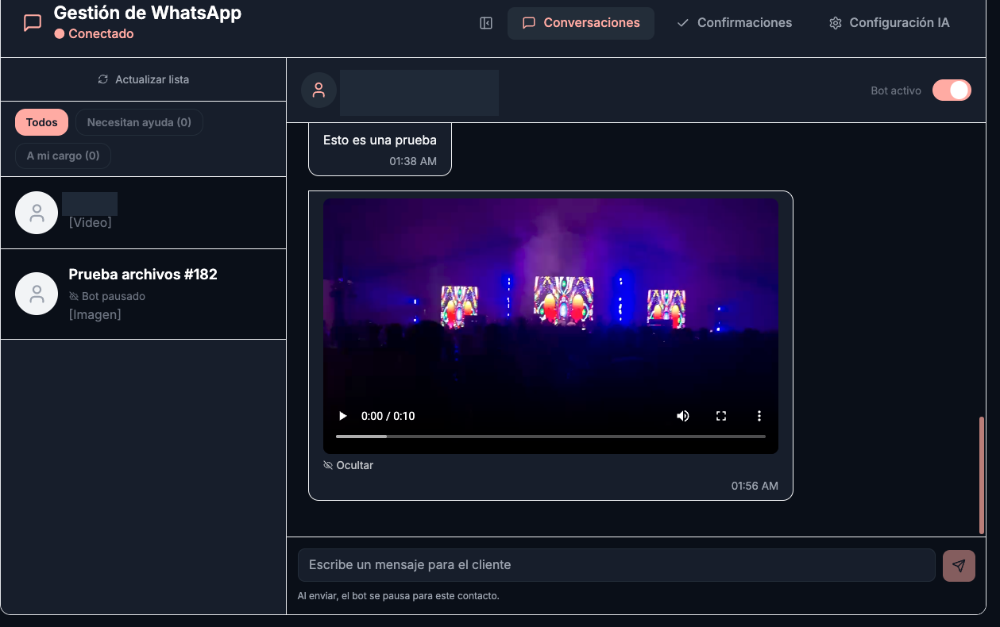
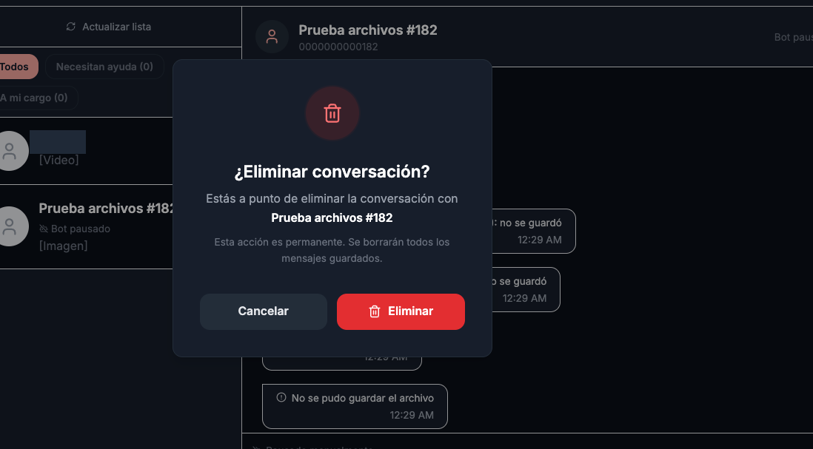
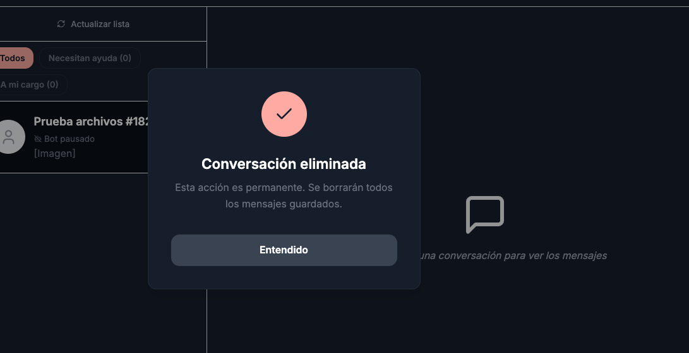

# Pruebas del ticket #182: archivos de WhatsApp en el panel

**Fecha:** 26-nov-2026 · **Rama:** `feat/182-media-backend` · **Negocio:** solo el de pruebas (`newy`)

> **Nada de esto está en producción.** La prueba se hizo con la app corriendo en la máquina del dueño, sobre una copia local de la base de datos y con una carpeta de archivos de prueba. La base real, el flujo automatizado y la app desplegada no cambiaron.

## Qué demuestra esta prueba y qué no

| Sí demuestra | No demuestra |
|---|---|
| Que el chat muestra foto, audio, video y documento; descarga; ocultar y restaurar con rastro; letreros; borrar el chat | Que un mensaje real recorre el flujo automatizado y llega igual al panel de producción |
| Que el archivo se guarda en privado, con un enlace que caduca a los 5 minutos y respeta el nombre de descarga | La pieza de la app que pide el archivo a la conexión de WhatsApp: todavía no existe; en la prueba lo hizo un programa aparte |
| Que la conexión de WhatsApp entrega un archivo real con solo la llave del mensaje, con su tamaño conocido antes de bajarlo | La respuesta del bot a un paciente, su pausa y el aviso al equipo: el celular de prueba es un número del equipo y el bot lo ignora |
| Que el texto que acompaña a una foto se recupera | El comportamiento en la app desplegada (variables del servidor, límite de tamaño de respuesta) |

## Niveles de prueba usados

- **Pruebas automáticas:** `npx tsx --test tests/*.test.ts` (1,572 pruebas, 0 fallas, 6 saltadas que no son de este cambio) y `npx tsc --noEmit`.
- **Visto por el dueño en su navegador**, en la app local.
- **Verificado con una consulta de solo lectura** en la copia local de la base.
- **Visto con un mensaje real:** archivos mandados por WhatsApp desde un celular de prueba a la línea del negocio de pruebas.

## Parte 1. Casos cargados por un script (sin teléfono)

Un script local cargó 16 archivos inventados en un chat llamado "Prueba archivos #182". El script solo corre contra la copia local y la carpeta de prueba, y nunca llama a rutas que envían mensajes.

| Caso | Resultado | Evidencia |
|---|---|---|
| Video | Reproductor dentro del chat |  |
| PDF con nombre largo, documento y audio mandado como documento | El nombre completo se parte en renglones sin romper el diseño. El PDF ofrece "Abrir en otra pestaña"; lo demás, "Descargar". Nada que llega como documento se dibuja dentro del chat |  |
| PDF abierto | Se abre en otra pestaña con el visor del navegador |  |
| Descarga del documento | El navegador propone el nombre original del archivo | Visto por el dueño (la captura mostraba carpetas personales y no se incluye) |
| Ocultar un archivo | En su lugar aparece "Archivo eliminado por <cuenta> el <fecha>" con "Restaurar" |  |
| Letreros | Demasiado grande, tamaño desconocido, ya no disponible, no se pudo guardar, guardando |  |

Rastro de ocultar y restaurar en la copia local después de la prueba: 3 veces ocultado y 2 restaurado, todas por la cuenta del dueño. La fecha de destrucción no cambió.

## Parte 2. Archivos reales mandados por WhatsApp

El dueño mandó cada archivo desde su celular de prueba, con aviso previo de qué número recibe qué. Un programa local, fuera del repo, leyó de la conexión de WhatsApp (solo dos lecturas: mensajes nuevos y el archivo) y entregó cada mensaje a la app local, que aplicó sus reglas y lo guardó en la carpeta de prueba.

| Archivo | Peso | La conexión lo entrega con la llave | Guardado en la copia local | Visto por el dueño |
|---|---|---|---|---|
| Foto | 45 KB | Sí, bytes iguales a los declarados | Sí, reconocida como JPEG | Sí: miniatura, se amplía, cierra con X y con Esc |
| Nota de voz | 8 KB | Sí | Sí, reconocida como audio | Sí: suena y la duración coincide |
| Foto con texto | 26 KB | Sí, con su texto | Sí, con el texto | Sí: foto y texto, sin el letrero "[Imagen]" |
| Video | 2.1 MB | Sí, en menos de un segundo | Sí, reconocido como MP4 | Sí: arranca, tiene duración y se pausa |

En las capturas el número y el nombre del contacto están tapados.

### Borrar un chat

El dueño borró el chat de su celular de prueba desde el panel local.

Verificado en la copia local después de borrar: las 5 fichas de archivo de ese chat quedaron sin chat, marcadas para destrucción, y sin nombre de archivo ni texto. La copia en la carpeta se borra en la siguiente corrida de la tarea de limpieza (en local se corre a mano).

La primera captura muestra el cuadro de confirmación abierto sobre el chat de prueba; el chat que quedó borrado en la copia local es el del celular de prueba.

## Lo que se vio en producción con esos mismos mensajes

Solo lectura, sobre el negocio de pruebas.

- Foto, nota de voz y las dos fotos siguientes: quedaron en el chat de producción como "[Imagen]" o "[Audio]", sin respuesta del bot, sin pausa y sin aviso al equipo. Es lo esperado para un número del equipo.
- La foto con texto quedó como "[Imagen]", sin el texto: el flujo automatizado lo quita antes de pasarlo a la app. El texto sí llega desde WhatsApp.
- **El video de 2.1 MB no llegó.** La conexión de WhatsApp lo tiene, pero el flujo del bot nunca arrancó: no hay renglón en el chat, ni respuesta, ni aviso. Ver la sección siguiente.

## Hallazgo de producción, fuera de este ticket (pertenece a #154)

| Archivo | Peso | ¿Arrancó el flujo del bot? | ¿Quedó en el chat de producción? |
|---|---|---|---|
| Nota de voz | 8 KB | Sí | Sí |
| Foto | 26 KB | Sí | Sí |
| Foto con texto | 26 KB | Sí | Sí, sin el texto |
| Foto | 45 KB | Sí | Sí |
| Video | 2.1 MB | **No** | **No** |

- En los 1,021 mensajes guardados desde el 12-nov, el archivo más pesado que ha llegado al flujo es una foto de unos 175 KB. Nunca ha llegado un video ni un documento.
- Causa sin verificar. Lo que se sabe: el aviso que recibe el flujo lleva el archivo completo adentro. Lo inferido: con un video ese aviso pesa unos 3 MB y algo en el camino lo rechaza antes de que el flujo arranque.
- Este ticket muestra que el archivo se puede pedir después con la llave del mensaje, así que el aviso no necesita llevarlo adentro.

## Lo que falta probar

- Desde un teléfono: documento, PDF, "ver una vez", sticker y un video pequeño (para saber si lo que se pierde en producción depende del peso).
- Que un archivo siga disponible una hora y un día después de enviado.
- Notas de voz grabadas en iPhone.
- La respuesta del bot con la línea nueva, la pausa y el aviso al equipo, desde un teléfono que no sea del equipo.
- La cuenta de la asistente en el panel.
- Modo oscuro, colores del negocio muy claros y muy oscuros, anchos de celular y teclado, en una ronda de navegador. Las auditorías de interfaz que pide el repo no existen en la máquina; las reglas de color y de textos se revisaron a mano.
- Que un negocio no pueda abrir los archivos de otro en la app desplegada: hoy lo cubren las pruebas automáticas; la prueba real necesita un segundo negocio de prueba.
- La destrucción a los 30 días contra la carpeta real: hoy la cubren las pruebas con reloj adelantado.

## Limpieza después de la prueba

Pendiente y a cargo del dueño: borrar el chat de prueba y sus archivos de la carpeta de prueba (el script tiene un comando para eso), apagar la app local y decidir si la línea del negocio de pruebas se queda conectada.
