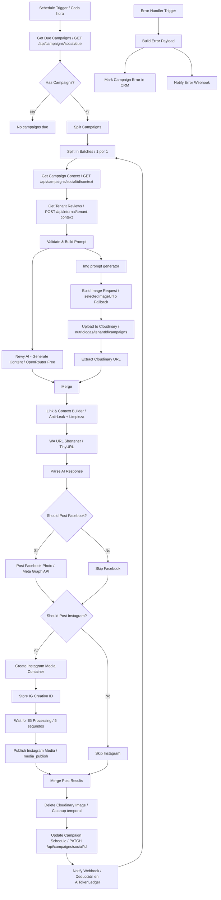

# Documentación Técnica: Flujo de Automatización de Campañas Sociales (n8n)

> **Archivo del Flujo**: `n8n/workflows/n8n-social-campaign-workflow.json`  
> **Arquitectura**: Next.js 14 API-First · Multi-Tenant · OpenRouter Free Models · Meta Graph API v19.0 · Cloudinary

---

## 1. Principios Fundamentales de Arquitectura

1. **API-First (Cero Conexión Directa a Base de Datos en n8n)**:
   - n8n **nunca** contiene nodos de conexión directa a PostgreSQL ni ejecuta sentencias SQL.
   - Toda lectura, actualización o mutación de datos se realiza a través de las rutas REST internas de Next.js autenticadas con el header `x-internal-secret`.
2. **Aislamiento Multi-Tenant**:
   - Cada tenant (clínica, tienda, restaurante) opera con datos y credenciales aisladas.
   - Las imágenes subidas a Cloudinary se organizan bajo el espacio del tenant: `nutriologas/{{ tenantId }}/campaigns`.
3. **Selección Dinámica de Imágenes (Sin URLs Hardcodeadas)**:
   - El usuario elige la fotografía exacta desde la interfaz CRM (`/admin/social-campaign`).
   - La selección se almacena en `SocialCampaign.selectedImageUrl` en la base de datos PostgreSQL.
   - n8n consume esta URL mediante el endpoint de contexto (`/api/campaigns/social/[id]/context`).

---

## 2. Mapa de Nodos del Flujo



---

## 3. Detalle Paso a Paso del Pipeline

### 3.1 Detección de Campañas (`Get Due Campaigns`)
- **Endpoint**: `GET https://www.newaigent.com/api/campaigns/social/due`
- **Filtro del Backend**:
  ```ts
  where: {
    isActive: true,
    pausedByCredits: false,
    nextPostAt: { lte: new Date() },
    startDate: { lte: new Date() },
    endDate: { gte: new Date() }
  }
  ```

### 3.2 Hidratación de Contexto (`Get Campaign Context` & `Get Tenant Reviews`)
- `GET /api/campaigns/social/{{ $json.id }}/context`:
  - Retorna `campaign` (incluyendo `selectedImageUrl` y `tenantId`), `tenant`, `products` y credenciales de Meta (`facebook.accessToken`, `facebook.pageId`, `instagram.igUserId`).
- `POST /api/internal/tenant-context`:
  - Recupera reseñas reales con calificación ≥ 4 estrellas para enriquecer el tono y prueba social.

### 3.3 Motor de Banners Publicitarios y Selección de Imagen (`Build Image Request`)
El nodo selecciona o genera la imagen base y luego invoca el endpoint interno `POST /api/internal/render-post-banner` para generar la imagen publicitaria compuesta (con degradado inferior oscuro, titular de alto contraste, soporte y botón de acción estilo píldora):

1. **Selección o Generación de la Foto Base (6 Casos de Prueba)**:
   - **Caso 1 (Instagram — Sin imagen de producto)**: Genera imagen limpia con IA (Pollinations Flux), compone el banner y publica en Instagram.
   - **Caso 2 (Instagram — Con imagen de producto)**: Obtiene la foto principal del producto seleccionado en Cloudinary (`product.images[0]`), compone el banner y publica en Instagram.
   - **Caso 3 (Facebook — Sin imagen de producto)**: Genera imagen limpia con IA (Pollinations Flux), compone el banner y publica en Facebook.
   - **Caso 4 (Facebook — Con imagen de producto)**: Obtiene la foto principal del producto seleccionado en Cloudinary (`product.images[0]`), compone el banner y publica en Facebook.
   - **Caso 5 (Instagram + Facebook — Sin imagen de producto)**: Genera imagen limpia con IA (Pollinations Flux), compone el banner publicitario y publica **el mismo banner** en ambas redes.
   - **Caso 6 (Instagram + Facebook — Con imagen de producto)**: Obtiene la foto principal del producto seleccionado en Cloudinary (`product.images[0]`), compone el banner publicitario y publica **el mismo banner** en ambas redes.

   *Nota de Generación IA*: El prompt describe exclusivamente la escena fotográfica visual con exclusión explícita de texto (`strictly no text, no letters, no words, no signs`). Todo el texto comercial (en perfecto español e inglés) se renderiza de forma nítida en el paso siguiente por el motor de banners.
2. **Composición Gráfica con Textos de Conversión (`POST /api/internal/render-post-banner`)**:
   - Llama a `POST /api/internal/render-post-banner` enviando:
     ```json
     {
       "imageUrl": "<foto_base_o_generada_por_ia>",
       "tenantId": "<tenant_id>",
       "hero": "<titular_o_nombre>",
       "heroHighlight": "<palabra_o_precio_a_destacar>",
       "support": "<beneficio_o_garantia>",
       "cta": "<boton_de_accion>",
       "accentColor": "#00C853"
     }
     ```
   - El endpoint compone la imagen a 1080x1080 mediante una capa SVG vectorial que incluye:
     - **Degradado Inferior Oscuro (`scrim`)**: Fusión suave desde transparente (30% superior) hasta negro profundo 98% en la base, garantizando contraste y legibilidad 100% nítida incluso sobre fondos blancos o claros.
     - **Filtro de Sombra/Resplandor**: Garantiza separación perfecta entre el texto y cualquier fondo fotográfico.
     - **Titular en Negrita**: Tamaño grande, centrado y con tipografía optimizada.
     - **Subtítulo de Apoyo**: Beneficio o llamada de confianza en color claro legible.
     - **Botón Estilo Píldora Redondeada**: Botón centrado con radio `rx="32"`, padding horizontal generoso y color de acento vibrante.
   - Sube la composición directamente a Cloudinary en `nutriologas/{{ tenantId }}/campaigns` y retorna la URL pública final.

### 3.4 Almacenamiento en Cloudinary
- **Carpeta de Destino**: `nutriologas/{{ tenantId }}/campaigns`
- **Public ID**: `banner_{{ timestamp }}`
- **Limpieza Posterior**: Tras publicar en Meta, el nodo `Delete Cloudinary Image` remueve la copia temporal si aplica para mantener la cuota optimizada.

### 3.5 Generación de Copy con Modelos Gratuitos (`Newy AI - Generate Content`)
- **Proveedor**: OpenRouter API (`https://openrouter.ai/api/v1/chat/completions`)
- **Modelo Principal**: `google/gemini-2.0-flash-exp:free`
- **Cascada de Respaldo**:
  ```json
  "models": [
    "google/gemini-2.0-flash-exp:free",
    "meta-llama/llama-3.3-70b-instruct:free",
    "openrouter/free"
  ]
  ```
- **Protección Anti-Leak**:
  - Expresión regular que detecta y elimina etiquetas `<think>...</think>`.
  - Filtro contra fugas de system prompt o directivas internas hacia el usuario final.

### 3.6 Publicación Multi-Plataforma en Meta Graph API v19.0
- **Facebook**:
  - `POST /v19.0/{pageId}/photos`
  - Body: `{ url: imageToPost, published: true, message: facebookMessage, access_token }`
- **Instagram**:
  - Paso 1: `POST /v19.0/{igUserId}/media` con `image_url` y `caption`.
  - Paso 2: Nodo `Wait` de 5 segundos para permitir que Meta descargue y valide la imagen.
  - Paso 3: `POST /v19.0/{igUserId}/media_publish` con reintentos automáticos (`retryOnFail: true`, 3 intentos con 5s de intervalo).

### 3.7 Cierre de Ciclo, Reprogramación y Ledger
1. **Actualizar Próxima Fecha**:
   - `PATCH /api/campaigns/social/[id]` con `{ markPosted: true, postResults, postedAt }`.
   - El CRM recalcula automáticamente `nextPostAt` según la frecuencia (`DAILY`, `EVERY_3_DAYS`, `WEEKLY`, `BIWEEKLY`, `MONTHLY`).
2. **Notificar Webhook y Deducción de Créditos**:
   - `POST /api/webhooks/social-campaign`.
   - Registra el historial en `SocialPost`.
   - Invoca `recordTokenUsage()` en `AiTokenLedger` cobrando las tarifas comerciales establecidas. Si el tenant excede su crédito mensual, `pausedByCredits` se activa automáticamente en la base de datos.

---

## 4. Instrucciones para Importar o Actualizar en n8n

1. Abre tu panel de **n8n**.
2. Ve al flujo existente de Campañas Sociales o crea uno nuevo.
3. Haz clic en **Workflow Settings / Three Dots Menu (⋮)** → **Import from File**.
4. Selecciona el archivo [`n8n/workflows/n8n-social-campaign-workflow.json`](file:///d:/Documents/Projects/smartflows/nutriologas/n8n/workflows/n8n-social-campaign-workflow.json).
5. Verifica que las credenciales de Cloudinary (HTTP Basic Auth) y OpenRouter estén vinculadas.
6. Activa el flujo (**Active = true**).
